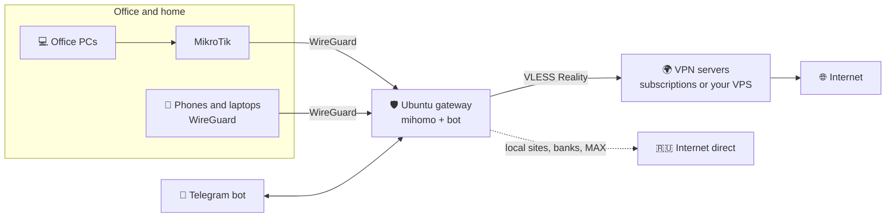

# 🛡 VPN gateway for office and home: MikroTik + WireGuard + VLESS, managed from Telegram

[Русский](README.md) · **English**

[](https://github.com/vvinograd/vpn-gateway/releases/latest)
[](LICENSE)


**One small Ubuntu server provides VPN to a whole office through MikroTik and to individual people over WireGuard.
Foreign traffic goes through a VPN server, local (Russian) traffic goes direct. Everything is managed in a Telegram
bot — no console needed.**

Installation is one script and a few questions, about 10 minutes. After that the gateway picks a working server
on its own, notices when something breaks, repairs itself and tells you in Telegram what happened.

> The bot and the installer speak Russian — the project was built for Russian networks (regional blocking,
> DPI, Russian apps that dislike VPNs). Button names below are given in English with the original in quotes.



## Why

| Problem | What the gateway does |
|---|---|
| Dozens of devices in the office; installing a VPN on each is slow and painful | MikroTik sends the right traffic to the gateway; nothing to install on devices |
| Local sites and banks break behind a VPN; Russian apps (MAX) complain about it | Local traffic goes direct, foreign — via VPN. Modes: smart, "selected services only", "blocked only", "everything via VPN" |
| The provider's VPN server is slow or blocks Telegram — you learn it from users | The gateway checks the server, Telegram and YouTube every minute, switches to a working one and reports in Telegram |
| Giving an employee access means opening a console | In the bot: "➕ Phone" → QR code or an email with the file, access period and traffic limit |
| Several servers — several admin panels | One bot for all gateways; admins get access per gateway |
| A server dies — set everything up again | Encrypted backups to Telegram, email, SFTP or Yandex.Disk; restore right from the installer |

## What the bot looks like


Notifications arrive by themselves: "⚠️ Server X blocks Telegram — switched to Y", "🆕 New version available",
"📅 A client's access is about to expire", "💾 Backup is ready".

## Features

**Connectivity and routing**
- **mihomo** — VLESS (Reality) client with automatic server selection across one or several subscriptions;
- **WireGuard** — phones, computers and MikroTik routers connect to the gateway (the wizard generates a ready `.rsc`);
- **routing by domain**, not only by IP: smart, "selected services only", "blocked only", "everything via VPN",
  custom exceptions; "🔎 Where does a site go" check;
- **your own VLESS server** on any VPS — the bot deploys it by IP and password;
- **zapret** — YouTube and other blocked services go direct without VPN: the gateway installs zapret, finds a DPI
  bypass strategy for its ISP, monitors it and moves a service to VPN on the fly if the bypass stops working.

**Reliability**
- **self-diagnostics**: stability of the current server, access to Telegram and YouTube, mihomo stalls;
- **self-healing**: switching to a working server without ping-pong, restarting a stalled mihomo,
  manual server choice with an expiry;
- **scheduled encrypted backups** and migration to a new server from a backup;
- **one-click updates** with automatic rollback if the new version fails to start.

**Management**
- **Telegram bot**: status, servers, traffic, speed test, WireGuard clients with QR and `.conf` (also by email),
  expiry and limits, subscriptions, notifications, multiple admins, clean chat;
- **several gateways in one bot** — the main gateway connects to the others over SSH with a restricted key.

## Installation

```bash
curl -fsSL https://raw.githubusercontent.com/vvinograd/vpn-gateway/main/install.sh -o install.sh
sudo bash install.sh
```

The wizard asks questions — you just answer. You will need a VPN subscription link (or `vless://` links)
and a bot token from [@BotFather](https://t.me/BotFather).

After installation, the management menu opens with `sudo vpngw-setup`.

### Moving to another server

1. In the bot: Settings → Backups → "Back up now" (or take the latest automatic backup).
2. On the new server run the installer and choose "Restore from backup": a file on the server, a link
   (Yandex.Disk, Google Drive, direct) or SFTP, then the backup password.
3. The wizard asks about the bot (same or new), email, subscription HWID and the address for clients.
4. Point the router's port forward to the new server and turn the old one off.

## Routing

Check a particular site: Routing → "🔎 Where does a site go" (or `/site address`) — the bot shows the rule,
the server and whether the site opens via VPN and directly.

Rules are checked top to bottom, the first match wins:

1. Local networks → direct.
2. Your exceptions "always via VPN" and "always direct".
3. MAX, Gosuslugi and the services apps use to detect their external IP → direct (in every mode; otherwise MAX
   sees different addresses and complains about a VPN).
4. zapret services (if enabled) → direct with DPI bypass, or VPN if the bypass does not work.
5. In "selected services only" mode — the services ticked in Routing → "📋 Services via VPN" (YouTube, Telegram,
   WhatsApp, Instagram, X, Discord, AI, GitHub, Notion, LinkedIn, Netflix, Spotify…) → VPN, everything else → direct.
   Services are matched by domain, plus IP ranges for Telegram, Meta, X and Netflix.
6. Blocked in Russia ([runetfreedom](https://github.com/runetfreedom/russia-v2ray-rules-dat) lists) → VPN.
7. Foreign AI services (ChatGPT, Claude, Gemini…) → VPN.
8. Smart mode only: "Russia-only" sites, .ru/.рф/.su domains, Russian services and IPs → direct.
9. Everything else → VPN (smart mode) or direct ("blocked only").

Russian domains are resolved via Yandex DNS; the lists are updated daily.

## zapret: blocked services direct

Routing → "🚀 zapret" → "Enable". The gateway:

1. checks that its own traffic leaves directly, not through the VPN (behind MikroTik a routing rule is needed —
   the bot shows it);
2. installs [zapret](https://github.com/bol-van/zapret) (builds `nfqws`) and nftables rules;
3. for each service (YouTube, Discord, LinkedIn, torrent trackers, X, Instagram/Facebook) finds a bypass for the
   ISP's DPI by trying known strategies with test requests;
4. sends the services that work direct: mihomo routes them to a `ZT-<service>` group = [ZAPRET, VPN], and nfqws
   disguises the first packets of those connections; QUIC is disabled for them.

Every 5 minutes each service is checked. If it stops opening it is moved to VPN immediately (a group selection,
no mihomo restart), and a new strategy is searched for in the background. Services that cannot be bypassed
(IP blocking, or the service itself refuses Russian users) stay on VPN; retries happen after 6, 12 and 24 hours.

## Your own server abroad

If you have a VPS (Ubuntu or Debian), the bot deploys VLESS Reality on it and adds it to the gateway as another
subscription — useful, for example, when Google sees the provider's servers as Russian.

**From the bot:** Management → "🛰 Own servers" → "➕ Deploy server". You need the IP and password (or an SSH key).
The bot logs in with the password once, installs its own key and uses only the key afterwards. It picks a port
(443 or a free one from 8443, 2053…) and a site to mimic, tests the server from Russia, shows which country Google
sees it in, and adds it to the gateway. Other VPNs on that server (SSTP, WireGuard) are left untouched.

**Manually on the server:**

```bash
curl -fsSL https://raw.githubusercontent.com/vvinograd/vpn-gateway/main/server/install-vless.sh -o install-vless.sh
sudo bash install-vless.sh
```

The script prints a `vless://` link — add it in the bot: Subscriptions → "➕ Add subscription". Other commands:
`show`, `rotate` (new keys), `update` (update Xray), `status`, `uninstall`.

## Several gateways in one bot

One bot can manage several gateways (office, a second server, a friend's server). The main gateway runs the
Telegram bot and connects to the secondary ones over SSH; their own bots go silent.

1. In the bot that will be the main one: Settings → "🏢 Gateways" → "➕ Connect another gateway here". Enter a name
   and the address the main gateway can reach over SSH. The bot sends a connection code.
2. In the secondary gateway's bot: Settings → "🏢 Gateways" → "🔗 Connect this gateway to the main one" → send the code.
3. Within a minute the main gateway connects. A "🏢 Gateway: … ⇄" row appears in the main menu; the whole menu
   works with the selected gateway.

The code contains only the main gateway's public key. The secondary gateway allows it for a single command
(`restrict` + forced command) — a bridge to its bot; no shell, no port forwarding. The owner sees all gateways;
admins get access per gateway. If the main server is gone, run `sudo python3 /usr/local/bin/vpnbot.py --unlink`
on the secondary one to bring its own bot back.

## WireGuard clients

- Phone: the WireGuard app → "+" → "Scan QR code" (AmneziaWG works too).
- Computer: WireGuard from [wireguard.com](https://www.wireguard.com/install/) → "Import tunnels from file".
- Each client can have an access period and a monthly traffic limit; it is disabled automatically when they run out.

If the gateway is behind a router, forward the WireGuard UDP port (51820 by default) to it.

A MikroTik is added in the bot (WireGuard → "➕ 📡 MikroTik"): the bot asks for the output of
`/ip address print terse proplist=address,interface; /interface wireguard print terse proplist=name,listen-port`,
picks a free port, checks the subnet and produces an `.rsc` file: tunnel only, the whole LAN, or selected addresses
via VPN. The gateway itself and local networks are excluded to avoid loops.

## Server commands

| Command | What it does |
|---|---|
| `sudo vpngw-setup` | menu: clients, status, updates, reinstall, uninstall |
| `vpngw status` | service status and the IP seen through the VPN |
| `vpngw peers` | list of clients |
| `vpngw add "Name" phone` | new client (`phone` or `pc`) |
| `vpngw qr "Name"` | QR code in the terminal and a file in `/root/wg-clients/` |

## Files on the server

| Path | Contents |
|---|---|
| `/etc/mihomo/config.yaml` | mihomo config |
| `/etc/wireguard/wg0.conf` | WireGuard |
| `/etc/vpnbot.env` | bot token, owner, update source |
| `/var/lib/vpnbot/state.json` | clients, admins, settings, statistics |
| `/etc/vpngw/` | wizard answers, version, auto-backup password (root only) |
| `/var/lib/vpnbot/backups/` | the last 5 backups (`.vpngw`) |
| `/var/log/vpngw-install.log` | installation and update log |

## License

[MIT](LICENSE) — free to use and modify.
