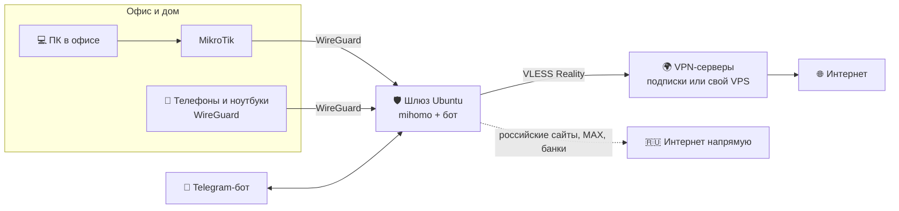
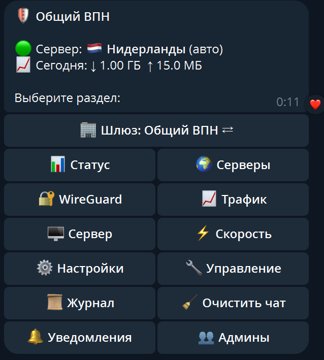

# 🛡 VPN-шлюз для офиса и дома: MikroTik + WireGuard + VLESS, управление из Telegram

**Русский** · [English](README.en.md)

[](https://github.com/vvinograd/vpn-gateway/releases/latest)
[](LICENSE)


**Один небольшой сервер на Ubuntu раздаёт VPN всему офису через MikroTik и отдельным людям по WireGuard.
Зарубежное идёт через VPN-сервер, российское — напрямую. Всё управление — в Telegram-боте, без консоли.**

Установка — один скрипт и ответы на вопросы, 10 минут. Дальше шлюз сам выбирает рабочий сервер, сам замечает,
если что-то сломалось, сам чинится и присылает в Telegram, что произошло.



## Зачем это

| Проблема | Что делает шлюз |
|---|---|
| В офисе десятки устройств, ставить VPN на каждое — долго и неудобно | MikroTik отправляет нужный трафик в шлюз, на устройствах ничего ставить не нужно |
| Через VPN не открываются российские сайты и банки, MAX жалуется на VPN | Российское идёт напрямую, зарубежное — через VPN. Режимы: умный, «только выбранные сервисы», «только заблокированное», «всё через VPN» |
| Сервер поставщика VPN «тормозит» или не пускает в Telegram — узнаёшь от пользователей | Шлюз каждую минуту проверяет сервер, Telegram и YouTube, при проблеме сам переходит на рабочий и пишет в Telegram |
| Выдать доступ сотруднику — значит лезть в консоль | В боте: «➕ Телефон» → QR-код или письмо с файлом, срок доступа и лимит трафика |
| Несколько серверов — несколько панелей | Один бот на все шлюзы, админам доступ выдаётся по шлюзам |
| Сервер умер — настраивать всё заново | Зашифрованный бэкап в Telegram, на почту, SFTP или Яндекс.Диск; переезд из копии прямо в установщике |

## Как выглядит бот



Экран 🔧 Управление → 🩺 Самодиагностика:

```
🩺 Самодиагностика
Сервер: 🇳🇱 Нидерланды (авто)
Устойчивость: 15 из 15 проверок прошли
Сервисы (только что): ✅ Telegram, ✅ YouTube
mihomo v1.19.32, приём соединений (TUN): system
Очередь новых соединений: 0 из 65535 🟢
Зависаний mihomo за сутки: 0
[🧪 Проверить все серверы]  [⚙️ Режим TUN: system]
```

Уведомления приходят сами: «⚠️ Сервер X не пускает в Telegram — переключился на Y», «🆕 Доступна новая версия»,
«📅 У клиента заканчивается доступ», «💾 Резервная копия готова».

## Возможности

**Связь и маршрутизация**
- **mihomo** — клиент VLESS (Reality) с автовыбором серверов из одной или нескольких подписок;
- **WireGuard** — к шлюзу подключаются телефоны, компьютеры и роутеры MikroTik (мастер выдаёт готовый `.rsc`);
- **маршрутизация** по доменам, а не только по IP: умная, «только выбранные сервисы», «только заблокированное»,
  «всё через VPN», свои исключения; проверка «🔎 Куда идёт сайт»;
- **свой VLESS-сервер** на любом VPS — бот разворачивает его сам по IP и паролю, в том числе прямо из
  установщика, если подписки ещё нет.
- **zapret** — YouTube и другие заблокированные сервисы напрямую, без VPN: шлюз сам ставит zapret, подбирает способ обхода под провайдера, следит за ним и при сбое на лету переводит сервис на VPN;

**Надёжность**
- **самодиагностика**: устойчивость текущего сервера, доступ к Telegram и YouTube, зависания mihomo;
- **самовосстановление**: переход на рабочий сервер без «пинг-понга», перезапуск зависшего mihomo,
  ручной выбор сервера с ограниченным сроком;
- **резервные копии** по расписанию с шифрованием и переезд на новый сервер из копии;
- **обновление кнопкой** со страховкой: если новая версия не запустилась или в первые 15 минут работает хуже
  прежней (mihomo, VPN, WireGuard), шлюз сам возвращает прежнюю версию; все шлюзы — одной кнопкой
  с главного, по очереди;
- **обслуживание Ubuntu**: обновления безопасности ставятся сами, остальные — кнопкой, перезагрузка после
  обновлений — ночью в 03:30–05:00 с отчётом утром; то же для своих VPS, включая обновление Xray с откатом;
- **mihomo обновляется сам** ночью (когда релизу 3 дня) и возвращается к прежней версии, если VPN стал хуже;
- **письмо на почту**, если Telegram недоступен больше 10 минут, — с подсказкой, как управлять шлюзом из консоли.

**Управление**
- **Telegram-бот**: статус, серверы, трафик, тест скорости, клиенты WireGuard с QR и `.conf` (в том числе письмом),
  сроки и лимиты, подписки, уведомления, несколько администраторов, чистый чат;
- **несколько шлюзов в одном боте** — главный сам подключается к ведомым по SSH с ограниченным ключом;
- **консоль без Telegram**: `sudo vpngw` открывает то же меню, что в боте, прямо на сервере; `vpngw top` —
  живая панель нагрузки; в боте то же — 🖥 Сервер → 📊 Монитор (раз в 3 секунды).

## Установка

```bash
curl -fsSL https://raw.githubusercontent.com/vvinograd/vpn-gateway/main/install.sh -o install.sh
sudo bash install.sh
```

Мастер задаёт вопросы, от вас нужны только ответы. Понадобятся ссылка на подписку VPN (или ссылки `vless://`)
и токен бота от [@BotFather](https://t.me/BotFather). Если подписки нет, но есть VPS за границей, выберите
«Развернуть свой сервер VLESS»: установщик сам поставит на него Xray, подберёт маскировку, проверит из России
и подключит — без VPN бот в Telegram из России не заработает.

После установки меню управления открывается командой `sudo vpngw-setup`.

### Переезд на другой сервер

1. В боте: ⚙️ Настройки → 💾 Резервные копии → «Сделать бэкап сейчас» (или возьмите последний автобэкап).
2. На новом сервере запустите установщик и выберите «Восстановить из резервной копии»:
   файл на сервере, ссылка (Яндекс.Диск, Google Диск, прямая) или SFTP, затем пароль копии.
3. Мастер спросит про бота (тот же или новый), почту, HWID подписки и адрес для клиентов.
4. Переключите проброс порта на роутере на новый сервер и выключите старый.

## Маршрутизация

Проверить конкретный сайт: 🧭 Маршрутизация → 🔎 Куда идёт сайт (или `/site адрес`) — бот покажет правило,
сервер и откроется ли сайт через VPN и напрямую.

Правила проверяются сверху вниз, срабатывает первое совпавшее:

1. Локальные сети → напрямую.
2. Ваши исключения «всегда через VPN» и «всегда напрямую».
3. MAX, Госуслуги и сервисы, через которые приложения узнают внешний IP → напрямую (в любом режиме:
   иначе MAX видит разные адреса и жалуется на VPN).
4. Сервисы zapret (если включён) → напрямую с обходом блокировки или через VPN, если обход не работает.
5. В режиме «Только выбранные сервисы» — отмеченные в 🧭 Маршрутизация → 📋 Сервисы через VPN (YouTube, Telegram,
   WhatsApp, Instagram, X, Discord, ИИ, GitHub, Notion, LinkedIn, Netflix, Spotify…) → VPN, всё остальное → напрямую.
   Сервисы определяются по доменам, а у Telegram, Meta, X и Netflix — ещё и по их IP-подсетям. Дальше этот режим
   правила не проверяет.
6. Заблокированное в РФ (базы [runetfreedom](https://github.com/runetfreedom/russia-v2ray-rules-dat)) → VPN.
7. Зарубежные ИИ-сервисы (ChatGPT, Claude, Gemini…) → VPN.
8. Только в «умном» режиме: сайты «только для России», домены .ru/.рф/.su, российские сервисы, российские IP → напрямую.
9. Всё остальное → VPN («умный» режим) или напрямую («только заблокированное»).

Российские домены резолвятся через Яндекс DNS, базы обновляются раз в сутки.

## zapret: заблокированное напрямую

🧭 Маршрутизация → 🚀 zapret → «Включить». Шлюз сам:

1. проверяет, что его собственный трафик уходит в интернет напрямую (за MikroTik нужно правило, бот подскажет);
2. ставит [zapret](https://github.com/bol-van/zapret) (собирает `nfqws`) и правила nftables;
3. для каждого сервиса (YouTube, Discord, LinkedIn, торрент-трекеры, X, Instagram/Facebook) подбирает способ
   обхода блокировки провайдера, перебирая известные стратегии тестовыми запросами;
4. пускает сервисы, для которых способ нашёлся, напрямую: mihomo отправляет их в группу `ZT-<сервис>` =
   [ZAPRET, VPN], а nfqws маскирует первые пакеты таких соединений; QUIC для них отключается.

Раз в 5 минут каждый сервис проверяется. Перестал открываться — переключается на VPN сразу, выбором в группе,
без перезапуска mihomo; в фоне подбирается новый способ. Сервисы, которым обход не помог (блокировка по IP или
сервис сам не пускает из России), остаются на VPN, новая попытка — через 6, 12, 24 часа. Уведомления —
в категории «🚀 zapret».

## Свой сервер за границей

Если у вас есть свой VPS (Ubuntu или Debian), бот сам поднимет на нём VLESS Reality и подключит его к шлюзу
второй подпиской. Это полезно, например, когда Google определяет серверы поставщика VPN как российские.

**Через бота:** 🔧 Управление → 🛰 Свои серверы → ➕ Развернуть сервер. Нужны IP и пароль (или SSH-ключ).
Бот один раз входит по паролю, кладёт на сервер свой ключ и дальше работает только по нему. Он сам выбирает порт
(443 или свободный из 8443, 2053…) и сайт для маскировки, проверяет сервер из России, показывает, какой страной
его видит Google, и добавляет в шлюз. Другие VPN на сервере (SSTP, WireGuard) не затрагиваются.

**Вручную на сервере:**

```bash
curl -fsSL https://raw.githubusercontent.com/vvinograd/vpn-gateway/main/server/install-vless.sh -o install-vless.sh
sudo bash install-vless.sh
```

Скрипт выдаст ссылку `vless://` — добавьте её в боте: 📦 Подписки → ➕ Добавить подписку. Другие команды:
`show`, `rotate` (новые ключи), `update` (обновить Xray, при неудаче вернётся прежняя версия), `status`,
`os-upgrade` (обновить систему), `reboot`, `uninstall`.

**Обслуживание.** На экране сервера видно версию Xray, обновления системы и нужна ли перезагрузка. Бот следит
за релизами Xray (пререлизы и отозванные версии пропускает) и в зависимости от режима сообщает о новой версии
или ставит её сам ночью, если ей уже 3 дня. Обновление проверяется из России до и после — не заработало,
возвращается прежняя. Ночью с 03:00 серверы обслуживаются по одному: Xray и перезагрузка, если её просит
система; утром приходит отчёт.

**Маскировка.** «🎭 Другая маскировка» ищет сайты-соседи в сети сервера (тот же дата-центр — такую маску
труднее заподозрить, чем крупный бренд на маленьком хостинге), затем запасной список. Каждый вариант бот
проверяет из России и применяет только после вашего подтверждения; без ответа за 10 минут сервер возвращает
прежнюю маску сам. «🔄 Проверить» сравнивает ссылку на сервере со ссылкой в шлюзе и предлагает обновить её,
если они разошлись.

**Починить.** Если сервер не работает из России, кнопка «🛠 Починить» перебирает по очереди совместимость с
шлюзом, версию Xray (прежнюю и предыдущие стабильные), новые ключи REALITY при прежней маске, маски и свободные
порты, проверяя каждый вариант из России, пока не найдёт рабочий. Версия Xray, с которой сервер перестал
работать, запоминается, и бот больше не ставит её сам.

**Ключи и откат.** Если после обновления Xray сервер не пускает шлюз со старыми параметрами, бот сам добавляет
настройку совместимости, затем пробует новые ключи (UUID, x25519, shortId): сервер ставит их на пробу с
таймером, бот проверяет из России и только тогда подтверждает и обновляет ссылку в шлюзе. Не помогло —
сервер сам возвращает прежние ключи, а бот откатывает Xray на прежнюю версию.

Через 🎯 Сервисы через подписку можно направить через свой сервер только нужные сервисы, например Google и Gemini.

## Несколько шлюзов в одном боте

Один бот может управлять несколькими шлюзами (офис, второй сервер, сервер у друзей) — не нужно держать по боту
на каждый сервер. Главный шлюз держит бота Telegram и сам подключается к ведомым по SSH, боты ведомых молчат.

**Как подключить:**

1. В боте, который станет главным: ⚙️ Настройки → 🏢 Шлюзы → ➕ Подключить другой шлюз сюда. Введите имя и адрес
   ведомого сервера, по которому до него можно достучаться по SSH с главного (`IP`, `домен` или `адрес:порт`).
   Бот пришлёт код подключения.
2. В боте ведомого шлюза: ⚙️ Настройки → 🏢 Шлюзы → 🔗 Подключить этот шлюз к главному → отправьте код.
3. В течение минуты главный подключится сам. Бот ведомого замолчит, а в главном меню появится «🏢 Шлюз: … ⇄» —
   переключение между шлюзами. Всё меню (клиенты WireGuard, маршрутизация, подписки, бэкапы, обновления)
   работает с выбранным шлюзом.

**Как это устроено.** В коде подключения только открытый ключ главного — секретов в нём нет. Ведомый создаёт
пользователя `vpngw-link` и разрешает этот ключ только для одной команды (`restrict` + forced command): переходника
к своему боту. Ни консоли, ни проброса портов по этому ключу нет. Ведомому нужен работающий SSH-сервер, доступный
с главного: если ведомый за роутером в другой сети — проброс порта на его роутере (бот подскажет команду для
MikroTik). Ключ сервера ведомого главный запоминает при первом подключении и дальше проверяет. Ведомый может писать
в Telegram только тем, у кого есть доступ к нему.

**Админы.** Владелец видит все шлюзы. Каждому админу шлюзы выдаются отдельно: 👥 Админы → 🏢 у нужного админа.
Уведомления ведомого приходят через главный бот с пометкой шлюза. Если ведомый пропал больше чем на 3 минуты,
главный пришлёт тревогу с причиной (VPN на ведомом при этом может работать — нет только управления).

**Обновление.** В ⚙️ Управление шлюзами у каждого шлюза видна версия. «⬆️ Обновить все шлюзы» обновляет ведомых
по одному — следующий начинает, только когда предыдущий вернулся на связь с новой версией, — а главный последним.
О новой версии сообщает только главный бот.

**Отключить шлюз:** 🏢 Шлюзы → ⚙️ Управление шлюзами → шлюз → 🔌 Отключить — его собственный бот снова заработает.
Если главный сервер недоступен, на ведомом выполните:

```bash
sudo python3 /usr/local/bin/vpnbot.py --unlink
```

Ключ главного входит в его резервную копию: после переезда главного на новый сервер из копии ведомые подключатся
без новых кодов. Если ведомый переустановили, в главном боте у этого шлюза нажмите «🔁 Принять новый ключ сервера»
и заново вставьте код в его бота.

## Клиенты WireGuard

- Телефон: приложение WireGuard → «+» → «Сканировать QR-код».
- Компьютер: WireGuard с [wireguard.com](https://www.wireguard.com/install/) → «Импорт туннелей из файла».
- В боте у клиента можно задать срок доступа и месячный лимит трафика: по истечении он отключается сам.

Если шлюз стоит за роутером, на роутере нужно пробросить UDP-порт WireGuard (по умолчанию 51820) на сервер.

MikroTik добавляется в боте (🔐 WireGuard → ➕ 📡 MikroTik) или командой
`sudo vpngw mikrotik "Офис" 192.168.88.0/24 [внешний_интерфейс]`. Бот попросит вывод команды проверки
(адреса, интерфейсы WireGuard, маршрут по умолчанию), подберёт свободный порт, проверит подсеть, найдёт
внешний интерфейс и выдаст команды RouterOS 7.4+: только туннель, вся локальная сеть или выбранные адреса
через VPN.
- Сам шлюз и локальные сети исключены — петли не будет; проброшенные снаружи порты отвечают как раньше,
  через провайдера; соединения через туннель не попадают в fasttrack.
- Если шлюз или VPN перестают пропускать трафик (netwatch раз в 10 секунд открывает настоящее соединение
  через туннель), маршрут в туннель выключается и сеть идёт в интернет напрямую; когда всё оживает —
  обратно. Шлюз может стоять в той же сети, что и MikroTik.
- Команды можно выполнять повторно: сначала они убирают то, что добавляли раньше.

Адрес для подключения (🔐 WireGuard → 🌐 Адрес) может быть доменом и IP одновременно: домен — основной
(переживёт смену IP и переключение на резервного провайдера), IP — запасной. После смены адреса кнопка
«📧 Разослать новые конфиги» отправит всем клиентам с почтой обновлённые файлы.

## Сервер «в разрыв» перед роутером

Если на сервере два сетевых порта, его можно поставить между провайдером и роутером другой сети (например,
сети с камерами и Wi-Fi за UniFi USG):

```
провайдер → [основной порт] шлюз [второй порт] → WAN роутера → сеть за роутером
```

Настраивается в установщике (он сам спросит, если найдёт второй порт) или потом: `sudo vpngw-setup` →
«Второй сетевой порт». Нужно выбрать порт и адрес шлюза на нём (по умолчанию `172.31.250.1/30`); установщик
покажет, что ввести в WAN роутера: статический IP `172.31.250.2`, маска `255.255.255.252`, шлюз
`172.31.250.1`, DNS `1.1.1.1` и `77.88.8.8`.

- Что идёт через VPN, решает общий режим маршрутизации (для такой сети подходят «Только заблокированное» и
  «Умная»). DNS-запросы тоже проходят через mihomo, поэтому заблокированное открывается и с обычными DNS.
- Если mihomo не работает, сеть за роутером идёт в интернет напрямую, а не остаётся без связи.
- Если сам сервер выключен, сеть за роутером без интернета: поставьте ИБП и автоматическое включение после
  подачи питания в BIOS.
- Адрес порта закрепляется через netplan (`/etc/netplan/60-vpngw-lan2.yaml`), маршрут и NAT ставит служба
  `vpngw-lan2`, правило маршрута проверяет сторож бота.

## Ubuntu: обновления и ночная перезагрузка

🔧 Управление → 🐧 Ubuntu. Шлюз раз в сутки проверяет обновления. Исправления безопасности ставятся сами
(unattended-upgrades), остальное — кнопкой «📦 Обновить»: пакеты обновляются в фоне, VPN не прерывается, итог
приходит сообщением. Если Ubuntu просит перезагрузку (обычно после нового ядра), шлюз делает её сам ночью,
не чаще раза за ночь, и после загрузки присылает отчёт: сколько не было VPN и какое ядро теперь.

Окно 03:00–05:00 по времени сервера: свои VPS с 03:00, ведомые шлюзы с 03:30, главный с 04:15. Ночную
перезагрузку можно выключить. MPTCP на шлюзе и VPS выключен (`net.mptcp.enabled=0`) из-за CVE-2026-98432.

## Консоль: управление без Telegram

Если Telegram недоступен (VPN не работает, бот заблокирован, владелец потерял доступ), шлюзом управляют
с самого сервера по SSH. `sudo vpngw` без аргументов открывает **меню бота в консоли**: те же экраны и кнопки,
выбор цифрой, текстовые ответы — как сообщения боту. Файлы, которые бот прислал бы в чат (конфиги, копии),
сохраняются в `/root/vpngw-files/`. Консоль работает через запущенного бота (сокет только для root), а если
бот не запущен — выполняет то же самое сама.

| Команда | Что делает |
|---|---|
| `sudo vpngw` | меню бота в консоли |
| `sudo vpngw help` | все команды |
| `sudo vpngw status` / `top` | состояние служб; живая панель: процессор, память, сеть, соединения, сервер |
| `sudo vpngw diag` | самодиагностика |
| `sudo vpngw servers` / `use <сервер\|auto>` | серверы VPN; выбрать вручную или вернуть автовыбор |
| `sudo vpngw mode` / `route` / `site <адрес>` | режим переключения, маршрутизация, куда идёт сайт |
| `sudo vpngw direct on\|off` | аварийно: клиенты WireGuard напрямую, без VPN |
| `sudo vpngw peers` / `add` / `qr` / `del` | клиенты WireGuard |
| `sudo vpngw mikrotik "Имя" <сеть> [wan]` | MikroTik: ключ и готовые команды |
| `sudo vpngw vps [list\|check N\|fix N\|xray N\|reboot N]` | свои серверы VLESS |
| `sudo vpngw tg test` / `tg owner <ID>` | проверить связь с Telegram; сменить владельца бота |
| `sudo vpngw backup now\|list\|check <файл>` | резервные копии (check — проверить, что копия читается) |
| `sudo vpngw update [check\|mihomo]` / `rollback` | обновить шлюз или mihomo; вернуть версию до обновления |
| `sudo vpngw os check\|upgrade\|reboot` | Ubuntu |
| `sudo vpngw restart <служба>` / `logs <служба> [N]` | перезапуск и журналы: bot, mihomo, wg, install, os |
| `sudo vpngw-setup` | меню установщика: то же меню бота, клиенты, обновления, откат, переустановка, удаление |

## Выпуск новой версии (для владельца репозитория)

1. Внесите изменения в `vpnbot.py`, `src/vpngw.py` или `src/install.sh`.
2. Увеличьте номер в `VERSION.in` (например `1.1` → `1.2`) и допишите раздел `## 1.2` в начало списка в `CHANGELOG.md`.
3. Запустите `./build.sh` (Linux или WSL). Он соберёт `install.sh` и обновит `VERSION` с контрольной суммой.
4. Загрузите на GitHub все изменённые файлы, обязательно `install.sh`, `VERSION` и `CHANGELOG.md`.

В течение суток все серверы пришлют в Telegram «🆕 Доступна новая версия». Обновление запускается кнопкой,
настройки и клиенты сохраняются, а если новая версия не запустилась, автоматически возвращается прежняя.

Серверы доверяют этому репозиторию, поэтому обязательно включите двухфакторную аутентификацию на GitHub.

## Файлы на сервере

| Путь | Содержимое |
|---|---|
| `/etc/mihomo/config.yaml` | конфиг mihomo |
| `/etc/wireguard/wg0.conf` | WireGuard |
| `/etc/vpnbot.env` | токен бота, владелец, источник обновлений |
| `/var/lib/vpnbot/state.json` | клиенты, админы, настройки, статистика |
| `/etc/vpngw/` | ответы мастера установки, номер версии, пароль автобэкапа (только root) |
| `/etc/vpngw/lan2.conf` | второй сетевой порт: имя порта и адрес (если настроен) |
| `/var/lib/vpnbot/backups/` | 5 последних резервных копий (`.vpngw`) |
| `/var/log/vpngw-install.log` | журнал установки и обновлений |

## Лицензия

[MIT](LICENSE) — можно свободно использовать и изменять.
