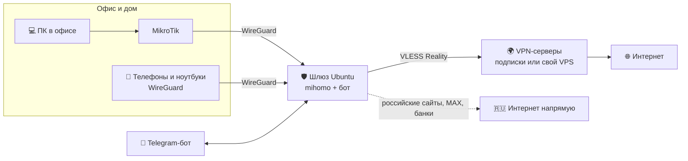
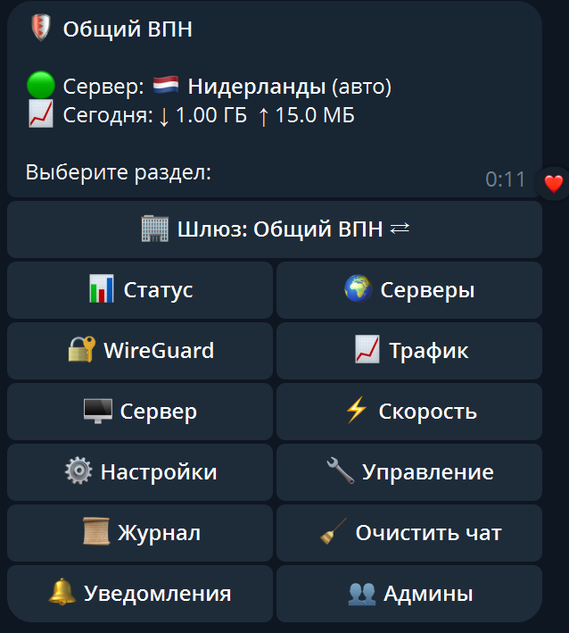

# 🛡 VPN-шлюз для офиса и дома: MikroTik + WireGuard + VLESS, управление из Telegram

**Русский** · [English](README.en.md)

[](https://github.com/vvinograd/vpn-gateway/releases/latest)
[](LICENSE)


**Один небольшой сервер на Ubuntu раздаёт VPN всему офису через MikroTik и отдельным людям по WireGuard.
Зарубежное идёт через VPN-сервер, российское — напрямую. Всё управление — в Telegram-боте, без консоли.**

Установка — один скрипт и ответы на вопросы, 10 минут. Дальше шлюз сам выбирает рабочий сервер, сам замечает,
если что-то сломалось, сам чинится и присылает в Telegram, что произошло.



## Зачем это

| Проблема | Что делает шлюз |
|---|---|
| В офисе десятки устройств, ставить VPN на каждое — долго и неудобно | MikroTik отправляет нужный трафик в шлюз, на устройствах ничего ставить не нужно |
| Через VPN не открываются российские сайты и банки, MAX жалуется на VPN | Российское идёт напрямую, зарубежное — через VPN. Режимы: умный, «только выбранные сервисы», «только заблокированное», «всё через VPN» |
| Сервер поставщика VPN «тормозит» или не пускает в Telegram — узнаёшь от пользователей | Шлюз каждую минуту проверяет сервер, Telegram и YouTube, при проблеме сам переходит на рабочий и пишет в Telegram |
| Выдать доступ сотруднику — значит лезть в консоль | В боте: «➕ Телефон» → QR-код или письмо с файлом, срок доступа и лимит трафика |
| Несколько серверов — несколько панелей | Один бот на все шлюзы, админам доступ выдаётся по шлюзам |
| Сервер умер — настраивать всё заново | Зашифрованный бэкап в Telegram, на почту, SFTP или Яндекс.Диск; переезд из копии прямо в установщике |

## Как выглядит бот



Экран 🔧 Управление → 🩺 Самодиагностика:

```
🩺 Самодиагностика
Сервер: 🇳🇱 Нидерланды (авто)
Устойчивость: 15 из 15 проверок прошли
Сервисы (только что): ✅ Telegram, ✅ YouTube
mihomo v1.19.32, приём соединений (TUN): system
Очередь новых соединений: 0 из 65535 🟢
Зависаний mihomo за сутки: 0
[🧪 Проверить все серверы]  [⚙️ Режим TUN: system]
```

Уведомления приходят сами: «⚠️ Сервер X не пускает в Telegram — переключился на Y», «🆕 Доступна новая версия»,
«📅 У клиента заканчивается доступ», «💾 Резервная копия готова».

## Возможности

**Связь и маршрутизация**
- **mihomo** — клиент VLESS (Reality) с автовыбором серверов из одной или нескольких подписок;
- **WireGuard** — к шлюзу подключаются телефоны, компьютеры и роутеры MikroTik (мастер выдаёт готовый `.rsc`);
- **маршрутизация** по доменам, а не только по IP: умная, «только выбранные сервисы», «только заблокированное»,
  «всё через VPN», свои исключения; проверка «🔎 Куда идёт сайт»;
- **свой VLESS-сервер** на любом VPS — бот разворачивает его сам по IP и паролю.
- **zapret** — YouTube и другие заблокированные сервисы напрямую, без VPN: шлюз сам ставит zapret, подбирает способ обхода под провайдера, следит за ним и при сбое на лету переводит сервис на VPN;

**Надёжность**
- **самодиагностика**: устойчивость текущего сервера, доступ к Telegram и YouTube, зависания mihomo;
- **самовосстановление**: переход на рабочий сервер без «пинг-понга», перезапуск зависшего mihomo,
  ручной выбор сервера с ограниченным сроком;
- **резервные копии** по расписанию с шифрованием и переезд на новый сервер из копии;
- **обновление кнопкой** с автоматическим откатом, если новая версия не запустилась.

**Управление**
- **Telegram-бот**: статус, серверы, трафик, тест скорости, клиенты WireGuard с QR и `.conf` (в том числе письмом),
  сроки и лимиты, подписки, уведомления, несколько администраторов, чистый чат;
- **несколько шлюзов в одном боте** — главный сам подключается к ведомым по SSH с ограниченным ключом.

## Установка

```bash
curl -fsSL https://raw.githubusercontent.com/vvinograd/vpn-gateway/main/install.sh -o install.sh
sudo bash install.sh
```

Мастер задаёт вопросы, от вас нужны только ответы. Понадобятся ссылка на подписку VPN (или ссылки `vless://`)
и токен бота от [@BotFather](https://t.me/BotFather).

После установки меню управления открывается командой `sudo vpngw-setup`.

### Переезд на другой сервер

1. В боте: ⚙️ Настройки → 💾 Резервные копии → «Сделать бэкап сейчас» (или возьмите последний автобэкап).
2. На новом сервере запустите установщик и выберите «Восстановить из резервной копии»:
   файл на сервере, ссылка (Яндекс.Диск, Google Диск, прямая) или SFTP, затем пароль копии.
3. Мастер спросит про бота (тот же или новый), почту, HWID подписки и адрес для клиентов.
4. Переключите проброс порта на роутере на новый сервер и выключите старый.

## Маршрутизация

Проверить конкретный сайт: 🧭 Маршрутизация → 🔎 Куда идёт сайт (или `/site адрес`) — бот покажет правило,
сервер и откроется ли сайт через VPN и напрямую.

Правила проверяются сверху вниз, срабатывает первое совпавшее:

1. Локальные сети → напрямую.
2. Ваши исключения «всегда через VPN» и «всегда напрямую».
3. MAX, Госуслуги и сервисы, через которые приложения узнают внешний IP → напрямую (в любом режиме:
   иначе MAX видит разные адреса и жалуется на VPN).
4. Сервисы zapret (если включён) → напрямую с обходом блокировки или через VPN, если обход не работает.
5. В режиме «Только выбранные сервисы» — отмеченные в 🧭 Маршрутизация → 📋 Сервисы через VPN (YouTube, Telegram,
   WhatsApp, Instagram, X, Discord, ИИ, GitHub, Notion, LinkedIn, Netflix, Spotify…) → VPN, всё остальное → напрямую.
   Сервисы определяются по доменам, а у Telegram, Meta, X и Netflix — ещё и по их IP-подсетям. Дальше этот режим
   правила не проверяет.
6. Заблокированное в РФ (базы [runetfreedom](https://github.com/runetfreedom/russia-v2ray-rules-dat)) → VPN.
7. Зарубежные ИИ-сервисы (ChatGPT, Claude, Gemini…) → VPN.
8. Только в «умном» режиме: сайты «только для России», домены .ru/.рф/.su, российские сервисы, российские IP → напрямую.
9. Всё остальное → VPN («умный» режим) или напрямую («только заблокированное»).

Российские домены резолвятся через Яндекс DNS, базы обновляются раз в сутки.

## zapret: заблокированное напрямую

🧭 Маршрутизация → 🚀 zapret → «Включить». Шлюз сам:

1. проверяет, что его собственный трафик уходит в интернет напрямую (за MikroTik нужно правило, бот подскажет);
2. ставит [zapret](https://github.com/bol-van/zapret) (собирает `nfqws`) и правила nftables;
3. для каждого сервиса (YouTube, Discord, LinkedIn, торрент-трекеры, X, Instagram/Facebook) подбирает способ
   обхода блокировки провайдера, перебирая известные стратегии тестовыми запросами;
4. пускает сервисы, для которых способ нашёлся, напрямую: mihomo отправляет их в группу `ZT-<сервис>` =
   [ZAPRET, VPN], а nfqws маскирует первые пакеты таких соединений; QUIC для них отключается.

Раз в 5 минут каждый сервис проверяется. Перестал открываться — переключается на VPN сразу, выбором в группе,
без перезапуска mihomo; в фоне подбирается новый способ. Сервисы, которым обход не помог (блокировка по IP или
сервис сам не пускает из России), остаются на VPN, новая попытка — через 6, 12, 24 часа. Уведомления —
в категории «🚀 zapret».

## Свой сервер за границей

Если у вас есть свой VPS (Ubuntu или Debian), бот сам поднимет на нём VLESS Reality и подключит его к шлюзу
второй подпиской. Это полезно, например, когда Google определяет серверы поставщика VPN как российские.

**Через бота:** 🔧 Управление → 🛰 Свои серверы → ➕ Развернуть сервер. Нужны IP и пароль (или SSH-ключ).
Бот один раз входит по паролю, кладёт на сервер свой ключ и дальше работает только по нему. Он сам выбирает порт
(443 или свободный из 8443, 2053…) и сайт для маскировки, проверяет сервер из России, показывает, какой страной
его видит Google, и добавляет в шлюз. Другие VPN на сервере (SSTP, WireGuard) не затрагиваются.

**Вручную на сервере:**

```bash
curl -fsSL https://raw.githubusercontent.com/vvinograd/vpn-gateway/main/server/install-vless.sh -o install-vless.sh
sudo bash install-vless.sh
```

Скрипт выдаст ссылку `vless://` — добавьте её в боте: 📦 Подписки → ➕ Добавить подписку. Другие команды:
`show`, `rotate` (новые ключи), `update` (обновить Xray), `status`, `uninstall`.

Через 🎯 Сервисы через подписку можно направить через свой сервер только нужные сервисы, например Google и Gemini.

## Несколько шлюзов в одном боте

Один бот может управлять несколькими шлюзами (офис, второй сервер, сервер у друзей) — не нужно держать по боту
на каждый сервер. Главный шлюз держит бота Telegram и сам подключается к ведомым по SSH, боты ведомых молчат.

**Как подключить:**

1. В боте, который станет главным: ⚙️ Настройки → 🏢 Шлюзы → ➕ Подключить другой шлюз сюда. Введите имя и адрес
   ведомого сервера, по которому до него можно достучаться по SSH с главного (`IP`, `домен` или `адрес:порт`).
   Бот пришлёт код подключения.
2. В боте ведомого шлюза: ⚙️ Настройки → 🏢 Шлюзы → 🔗 Подключить этот шлюз к главному → отправьте код.
3. В течение минуты главный подключится сам. Бот ведомого замолчит, а в главном меню появится «🏢 Шлюз: … ⇄» —
   переключение между шлюзами. Всё меню (клиенты WireGuard, маршрутизация, подписки, бэкапы, обновления)
   работает с выбранным шлюзом.

**Как это устроено.** В коде подключения только открытый ключ главного — секретов в нём нет. Ведомый создаёт
пользователя `vpngw-link` и разрешает этот ключ только для одной команды (`restrict` + forced command): переходника
к своему боту. Ни консоли, ни проброса портов по этому ключу нет. Ведомому нужен работающий SSH-сервер, доступный
с главного: если ведомый за роутером в другой сети — проброс порта на его роутере (бот подскажет команду для
MikroTik). Ключ сервера ведомого главный запоминает при первом подключении и дальше проверяет. Ведомый может писать
в Telegram только тем, у кого есть доступ к нему.

**Админы.** Владелец видит все шлюзы. Каждому админу шлюзы выдаются отдельно: 👥 Админы → 🏢 у нужного админа.
Уведомления ведомого приходят через главный бот с пометкой шлюза. Если ведомый пропал больше чем на 3 минуты,
главный пришлёт тревогу с причиной (VPN на ведомом при этом может работать — нет только управления).

**Отключить шлюз:** 🏢 Шлюзы → ⚙️ Управление шлюзами → шлюз → 🔌 Отключить — его собственный бот снова заработает.
Если главный сервер недоступен, на ведомом выполните:

```bash
sudo python3 /usr/local/bin/vpnbot.py --unlink
```

Ключ главного входит в его резервную копию: после переезда главного на новый сервер из копии ведомые подключатся
без новых кодов. Если ведомый переустановили, в главном боте у этого шлюза нажмите «🔁 Принять новый ключ сервера»
и заново вставьте код в его бота.

## Клиенты WireGuard

- Телефон: приложение WireGuard → «+» → «Сканировать QR-код».
- Компьютер: WireGuard с [wireguard.com](https://www.wireguard.com/install/) → «Импорт туннелей из файла».
- В боте у клиента можно задать срок доступа и месячный лимит трафика: по истечении он отключается сам.

Если шлюз стоит за роутером, на роутере нужно пробросить UDP-порт WireGuard (по умолчанию 51820) на сервер.

MikroTik добавляется в боте (🔐 WireGuard → ➕ 📡 MikroTik). Бот попросит вывод команды
`/ip address print terse proplist=address,interface; /interface wireguard print terse proplist=name,listen-port`,
подберёт свободный порт, проверит подсеть и выдаст файл `.rsc` с командами: только туннель, вся локальная сеть
или выбранные адреса через VPN. Сам шлюз и локальные сети в правилах исключены, чтобы не было петли.

Адрес для подключения (🔐 WireGuard → 🌐 Адрес) может быть доменом и IP одновременно: домен — основной
(переживёт смену IP и переключение на резервного провайдера), IP — запасной. После смены адреса кнопка
«📧 Разослать новые конфиги» отправит всем клиентам с почтой обновлённые файлы.

## Команды на сервере

| Команда | Что делает |
|---|---|
| `sudo vpngw-setup` | меню: клиенты, состояние, обновления, переустановка, удаление |
| `vpngw status` | состояние сервисов и IP через VPN |
| `vpngw peers` | список клиентов |
| `vpngw add "Имя" phone` | новый клиент (`phone` или `pc`) |
| `vpngw qr "Имя"` | QR-код в терминале и файл в `/root/wg-clients/` |

## Выпуск новой версии (для владельца репозитория)

1. Внесите изменения в `vpnbot.py`, `src/vpngw.py` или `src/install.sh`.
2. Увеличьте номер в `VERSION.in` (например `1.1` → `1.2`) и допишите раздел `## 1.2` в начало списка в `CHANGELOG.md`.
3. Запустите `./build.sh` (Linux или WSL). Он соберёт `install.sh` и обновит `VERSION` с контрольной суммой.
4. Загрузите на GitHub все изменённые файлы, обязательно `install.sh`, `VERSION` и `CHANGELOG.md`.

В течение суток все серверы пришлют в Telegram «🆕 Доступна новая версия». Обновление запускается кнопкой,
настройки и клиенты сохраняются, а если новая версия не запустилась, автоматически возвращается прежняя.

Серверы доверяют этому репозиторию, поэтому обязательно включите двухфакторную аутентификацию на GitHub.

## Файлы на сервере

| Путь | Содержимое |
|---|---|
| `/etc/mihomo/config.yaml` | конфиг mihomo |
| `/etc/wireguard/wg0.conf` | WireGuard |
| `/etc/vpnbot.env` | токен бота, владелец, источник обновлений |
| `/var/lib/vpnbot/state.json` | клиенты, админы, настройки, статистика |
| `/etc/vpngw/` | ответы мастера установки, номер версии, пароль автобэкапа (только root) |
| `/var/lib/vpnbot/backups/` | 5 последних резервных копий (`.vpngw`) |
| `/var/log/vpngw-install.log` | журнал установки и обновлений |

## Лицензия

[MIT](LICENSE) — можно свободно использовать и изменять.
